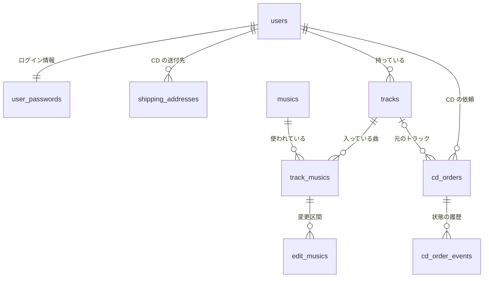

# データベースのテーブル一覧と構造

ローカルの MySQL（`ballet_conductor`）から 2026-10-07 に読み取った内容です。定義の元は `backend/db/init/01_tables.sql` です。

## テーブルどうしのつながり

親の行を消すと、それにひもづく行も一緒に消えます（`ON DELETE CASCADE`）。ただし `cd_orders.track_id` だけは、トラックを消すと空（NULL）になり、依頼は残ります。

## 一覧

| テーブル | 内容 | いまの行数 |
| --- | --- | --- |
| `users` | 利用者 | 1 |
| `user_passwords` | ログイン情報（利用者 1 人に 1 行） | 1 |
| `musics` | 曲 | 33 |
| `tracks` | トラック（曲をまとめたもの） | 1 |
| `track_musics` | トラックに入っている曲と、その並び順 | 3 |
| `edit_musics` | トラック内の曲に設定した変更区間（テンポ） | 1 |
| `shipping_addresses` | CD の送付先の住所（利用者 1 人に複数） | 0 |
| `cd_orders` | CD の作成依頼 | 0 |
| `cd_order_events` | CD の作成依頼の状態の履歴 | 0 |

どのテーブルにも、次の 3 つの列があります（以下の表では省略）。

| 列 | 型 | 内容 |
| --- | --- | --- |
| `id` | BIGINT UNSIGNED | 主キー（自動で番号が振られる） |
| `created_at` | DATETIME | 作成日時（UTC） |
| `updated_at` | DATETIME | 更新日時（UTC、更新すると自動で変わる） |

## users

| 列 | 型 | NULL | 制約 | 内容 |
| --- | --- | --- | --- | --- |
| `name` | VARCHAR(255) | 不可 | | 名前 |

## user_passwords

| 列 | 型 | NULL | 制約 | 内容 |
| --- | --- | --- | --- | --- |
| `user_id` | BIGINT UNSIGNED | 不可 | 一意、→ `users.id` | 利用者 |
| `email` | VARCHAR(255) | 不可 | 一意 | メールアドレス |
| `password` | TEXT | 不可 | | パスワードのハッシュ（bcrypt） |

## musics

| 列 | 型 | NULL | 制約 | 内容 |
| --- | --- | --- | --- | --- |
| `name` | VARCHAR(255) | 不可 | | 曲名 |
| `url` | TEXT | 不可 | | 音源の URL。`/` で始まるときはフロントのサイト内のファイル。空なら音源なし |

## tracks

| 列 | 型 | NULL | 制約 | 内容 |
| --- | --- | --- | --- | --- |
| `user_id` | BIGINT UNSIGNED | 不可 | インデックス、→ `users.id` | 持ち主 |
| `name` | VARCHAR(255) | 不可 | | トラック名 |

## track_musics

| 列 | 型 | NULL | 制約 | 内容 |
| --- | --- | --- | --- | --- |
| `track_id` | BIGINT UNSIGNED | 不可 | インデックス、→ `tracks.id` | トラック |
| `music_id` | BIGINT UNSIGNED | 不可 | インデックス、→ `musics.id` | 曲 |
| `position` | INT | 不可 | 既定値 0 | トラック内の並び順（小さいほど先） |

同じトラックに同じ曲は 1 回までですが、これは API で確かめていて、DB の制約はありません。

## edit_musics

| 列 | 型 | NULL | 制約 | 内容 |
| --- | --- | --- | --- | --- |
| `track_music_id` | BIGINT UNSIGNED | 不可 | インデックス、→ `track_musics.id` | どのトラックのどの曲か |
| `start_second` | INT | 不可 | | 区間の始まり（秒） |
| `end_second` | INT | 不可 | | 区間の終わり（秒） |
| `tempo` | INT | 不可 | | テンポ（%、50〜150） |

区間どうしが重ならないことや、テンポの範囲は API で確かめています。

## shipping_addresses

| 列 | 型 | NULL | 制約 | 内容 |
| --- | --- | --- | --- | --- |
| `user_id` | BIGINT UNSIGNED | 不可 | インデックス、→ `users.id` | 利用者 |
| `recipient_name` | VARCHAR(255) | 不可 | | 宛名 |
| `postal_code` | VARCHAR(8) | 不可 | | 郵便番号（例：150-0001） |
| `prefecture` | VARCHAR(10) | 不可 | | 都道府県 |
| `city` | VARCHAR(255) | 不可 | | 市区町村 |
| `address_line1` | VARCHAR(255) | 不可 | | 町名・番地 |
| `address_line2` | VARCHAR(255) | 可 | | 建物名・部屋番号 |
| `is_default` | BOOLEAN | 不可 | 既定値 false | デフォルトの送付先なら true |
| `default_user_id` | BIGINT UNSIGNED | 可 | 一意（自動で計算される列） | `is_default` が true のときだけ `user_id` が入る |

`default_user_id` に一意の制約があるので、デフォルトの送付先は 1 人 1 件までです。デフォルトを別の住所に替えるときは、いまのデフォルトを false にしてから新しい住所を true にします（1 つの UPDATE でまとめて替えることもできます）。

## cd_orders

| 列 | 型 | NULL | 制約 | 内容 |
| --- | --- | --- | --- | --- |
| `user_id` | BIGINT UNSIGNED | 不可 | インデックス、→ `users.id` | 依頼した利用者 |
| `track_id` | BIGINT UNSIGNED | 可 | インデックス、→ `tracks.id`（消すと NULL） | 元のトラック |
| `track_name` | VARCHAR(255) | 不可 | | 依頼した時点のトラック名 |
| `track_snapshot` | JSON | 不可 | | 依頼した時点の曲・順番・変更区間 |
| `recipient_name` | VARCHAR(255) | 不可 | | 宛名（依頼した時点） |
| `postal_code` | VARCHAR(8) | 不可 | | 郵便番号 |
| `prefecture` | VARCHAR(10) | 不可 | | 都道府県 |
| `city` | VARCHAR(255) | 不可 | | 市区町村 |
| `address_line1` | VARCHAR(255) | 不可 | | 町名・番地 |
| `address_line2` | VARCHAR(255) | 可 | | 建物名・部屋番号 |

`track_snapshot` の形：`{ "musics": [{ "position", "musicId", "name", "url", "edits": [{ "startSecond", "endSecond", "tempo" }] }] }`

## cd_order_events

`updated_at` はありません（履歴は書き換えず、足していくだけ）。

| 列 | 型 | NULL | 制約 | 内容 |
| --- | --- | --- | --- | --- |
| `cd_order_id` | BIGINT UNSIGNED | 不可 | インデックス、→ `cd_orders.id` | 依頼 |
| `event` | ENUM | 不可 | `requested` / `accepted` / `in_production` / `shipped` / `cancelled` | 依頼・受付・作成中・発送・取り消し |
| `note` | VARCHAR(255) | 可 | | メモ（例：送り状の番号） |

いまの状態は、`created_at`（同じなら `id`）が一番新しい行です。
